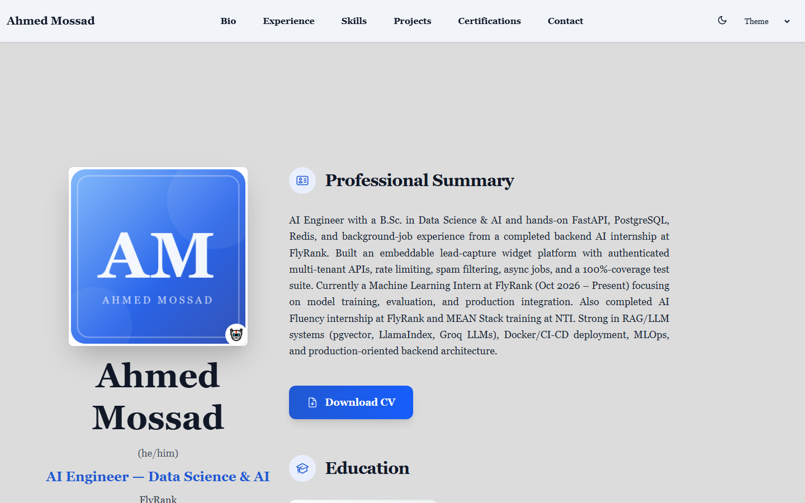

# Ahmed Mossad — Portfolio Website

[](https://ahmedm0ssad.github.io/)
[](https://gohugo.io/)
[](https://github.com/HugoBlox/hugo-theme-academic-cv)
[](https://github.com/ahmedm0ssad/ahmedm0ssad.github.io/actions)

The personal portfolio of **Ahmed Mossad** — AI Engineer (Data Science & AI), based in Giza, Egypt.
Single-page site with professional summary, certifications, experience timeline, skills,
a filterable project gallery, contact info, and key numbers.



## Live site

**https://ahmedm0ssad.github.io/**

## Homepage sections

| # | Section | Block | Content |
| - | ------------- | ------------------------ | ------------------------------------------------------- |
| 1 | About | `resume-biography-3` | Hero, professional summary, education, **Download CV** |
| 2 | Certifications | `resume-awards` | 3 industry certifications with verification links |
| 3 | Experience | `resume-experience` | 10 roles & activities with dates and highlights |
| 4 | Skills | `resume-skills` | 12 skill domains, grouped (no percentage bars) |
| 5 | Projects | `portfolio` | All **56 projects**, tag-filterable (All + 5 categories) |
| 6 | Contact | `contact-info` | Email, phone, location, GitHub & LinkedIn |
| 7 | Stats | `stats` | 56 Projects · 10 Roles & Activities · 12 Skill Domains · 3 Certifications |

## Where things live

| Path | Purpose |
| -------------------------------------- | ------------------------------------------------------------------ |
| `content/_index.md` | Homepage — defines all sections and their design |
| `data/authors/me.yaml` | **Single source of truth**: bio, experience, skills, certifications, contact |
| `content/projects/` | 56 project pages; tags drive the section's filter buttons |
| `assets/media/authors/me.png` | Avatar/monogram |
| `static/uploads/resume.pdf` | The downloadable CV |
| `config/_default/` | Hugo config (site params, menus, module mounts) |
| `.github/workflows/deploy.yml` | GitHub Pages deployment workflow |

## Run locally

Prerequisites: [Hugo extended](https://gohugo.io/installation/) (0.159+), [Go](https://go.dev/) 1.19+, Node.js for the Tailwind toolchain.

```bash
npm install                          # Tailwind CSS v4 + pagefind toolchain (pnpm works too)
hugo --cleanDestinationDir --gc -d public   # production build into ./public
hugo server --disableFastRender      # dev server at http://localhost:1313
```

> Tip: use `--cleanDestinationDir` when building repeatedly — it purges stale output that `--gc` alone won't remove.

## Deployment

Deploys automatically and for free via **GitHub Pages**:

- Every push to `main` runs the *Deploy website to GitHub Pages* workflow ([Actions tab](https://github.com/ahmedm0ssad/ahmedm0ssad.github.io/actions)).
- It can also be triggered manually with `workflow_dispatch`.
- No changes needed beyond editing content — push and the site updates in ~1 minute.

> **Visibility note:** this repo is currently **private**. On GitHub Free, new Pages deployments from a private repo can be restricted; the live site keeps serving the last successful deployment. If a future deploy is blocked, setting the repo back to public restores normal deploys.

## Contact

- **Email:** ahmed.abdelfattah.mossad@gmail.com
- **LinkedIn:** [ahmed-mossad-4528202b2](https://linkedin.com/in/ahmed-mossad-4528202b2)
- **GitHub:** [@ahmedm0ssad](https://github.com/ahmedm0ssad)

## Credits

Built on the open-source [Hugo Blox Academic CV template](https://github.com/HugoBlox/hugo-theme-academic-cv)
(MIT © [George Cushen](https://georgecushen.com)), styled with Tailwind CSS v4.
Site content © Ahmed Mossad — see [LICENSE.md](LICENSE.md) for the template license.